 

MSc in <b>Data Science, AI & Digital Business</b>, based in Berlin. 
I work between business needs and technology, starting with the problem and then choosing the approach. 
Currently seeking my first role in <b>technology consulting, business analytics or BI</b>.

&nbsp;

 

 

Define the question. Examine the evidence. Explain what it means. Agree the next step.

 

Currently strengthening SQL, building in Power BI and Streamlit, 
and testing small, practical AI ideas.

<b>Planned, not published yet</b>

 
A campaign performance dashboard and a Streamlit app exploring a practical AI use case. 
Repositories will be linked here once they exist.

 

