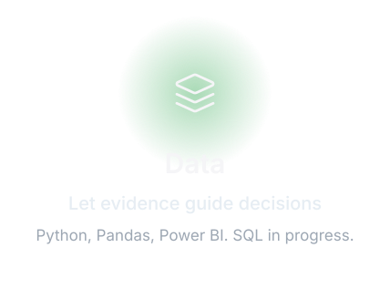

MSc in <b>Data Science, AI & Digital Business</b>. Berlin. 
I like working out what a business actually needs before anyone opens a tool. 
Now looking for my first role in <b>technology consulting, business analytics or BI</b>.

&nbsp;&nbsp;

Ask first. Check the evidence. Say what it means. Pick the next move.

Sharpening SQL, building in Power BI and Streamlit, 
and testing small, practical AI ideas.

<b>Planned, not published yet</b>

 
A campaign performance dashboard and a Streamlit app exploring a practical AI use case. 
Repositories will be linked here once they exist.

 

  

